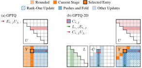

# GPTQ-2D: Cubic-Time Two-Sided Adaptive Rounding

[arXiv.org](https://arxiv.org/abs/2607.27042) |
[GitHub.com](https://github.com/IST-DASLab/GPTQ-2D) |
[Citation](#citation)

<p align="center">

</p>

Official repository for the paper "GPTQ-2D: Cubic-Time Two-Sided Adaptive Rounding" by _Jiale Chen_, _Torsten Hoefler_, and _Dan Alistarh_ from the _Institute of Science and Technology Austria (ISTA)_, _ETH Zürich_, and _Red Hat AI_.

**Keywords:** Quantization, Rounding, LLM

## Paper Abstract

**TL;DR:** GPTQ-2D is a cubic-time algorithm for two-sided adaptive rounding that exactly reproduces the quartic-time vectorized GPTQ result while enabling parallel computation.

> Adaptive rounding methods such as GPTQ quantize the weights of a large language model (LLM) one at a time, propagating each rounding error to the weights not yet rounded. YAQA lowers the KL divergence from the original model with two-sided adaptive rounding under a Kronecker-factored Hessian, but its error feedback takes quartic work in the size of a square layer. We present GPTQ-2D, which provably computes the same rounding with cubic work, while still rounding the entries of each anti-diagonal in parallel. Its GPU implementation uses two levels of blocking to improve hardware utilization. We also extend the algorithm to Hessians with any number of Kronecker factors. In our experiments, GPTQ-2D is as accurate as YAQA and cuts the time to quantize Llama-3.1-70B-Instruct on a single NVIDIA RTX A6000 GPU from 8.6 days to 1.6 hours.

Please read our full paper if you are interested in the research details.

## Requirements

<p>
<a href="https://www.python.org/downloads/"></a>
<a href="https://pytorch.org/get-started/"></a>
</p>

The code requires Python, PyTorch, and Triton (sometimes automatically installed by PyTorch).
The demo additionally requires Jupyter and Matplotlib.

## Files

| File | Contents |
| --- | --- |
| [demo.ipynb](./demo.ipynb) | Interactive examples with saved outputs |
| [gptq_2d.py](./gptq_2d.py) | Blocked Triton kernels, CUDA-graph capture, and batched PyTorch implementations, with super-entry variants |
| [gptq_2d_reference.py](./gptq_2d_reference.py) | PyTorch references for Algorithms 1-7, LDL helpers, and YAQA's paper listing |
| [quantizer_int.py](./quantizer_int.py) | Nearest-integer, affine, and INT absmax quantizers |
| [quantizer_trellis.py](./quantizer_trellis.py) | 1MAD, 3INST, and HYB codes, with PyTorch and Triton trellis searches |
| [test_gptq_2d.py](./test_gptq_2d.py) | Implementation comparisons, broadcasting, in-place operation, and CUDA graphs |

## Demo and Tests

Open [demo.ipynb](./demo.ipynb) for objective comparisons, checks against the reference algorithms and YAQA, sweep timings, and examples with INT4, custom FP4, and a 2-bit trellis.
Its saved outputs are from an NVIDIA RTX A6000.
Without a GPU, it runs the PyTorch implementations on smaller matrices and times only those.

Each module's tests run directly from this folder.
The first CUDA run compiles the Triton kernels.
```bash
python gptq_2d_reference.py
python quantizer_int.py
python quantizer_trellis.py
python test_gptq_2d.py
```

## Citation

Please cite our paper if you find it useful. Thank you!

**Plain text:**

```text
Jiale Chen, Torsten Hoefler, and Dan Alistarh. GPTQ-2D: Cubic-time two-sided adaptive rounding. arXiv preprint, 2026. URL https://arxiv.org/abs/2607.27042.
```

**BibTeX:**

```bibtex
@misc{chen2026gptq2dcubictimetwosidedadaptive,
      title={{GPTQ}-2{D}: Cubic-Time Two-Sided Adaptive Rounding}, 
      author={Jiale Chen and Torsten Hoefler and Dan Alistarh},
      year={2026},
      eprint={2607.27042},
      archivePrefix={arXiv},
      primaryClass={cs.DS},
      url={https://arxiv.org/abs/2607.27042}, 
}
```
